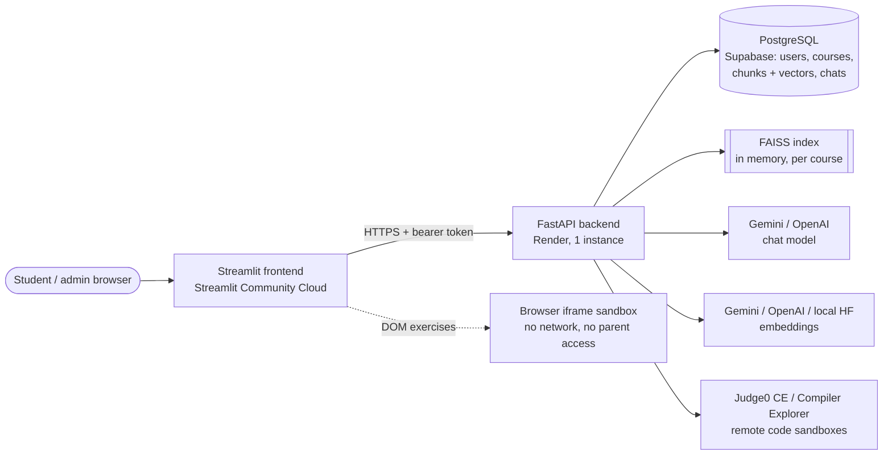
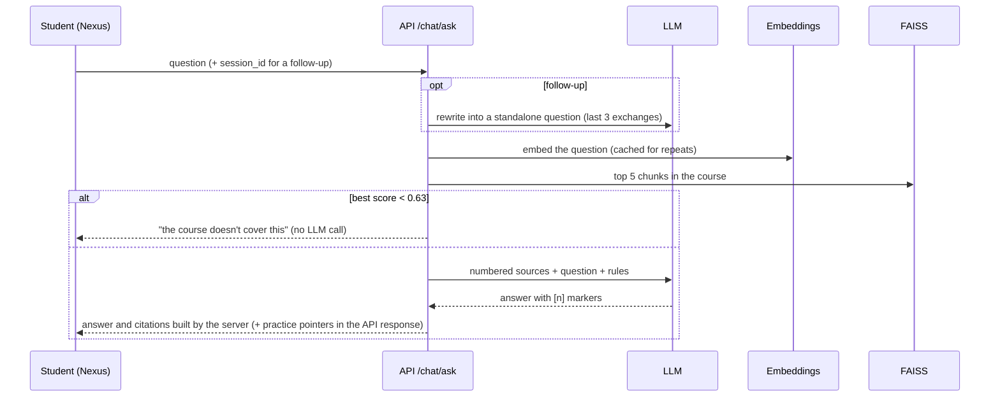

# Architecture

How the ArchintX Learning Assistant is built, why, and where its limits are. Setup is in the [README](../README.md); endpoints in [api.md](api.md); measured results in [evaluation.md](evaluation.md).

## Overview

- **Frontend** (`frontend/`): Streamlit in the LearnX style: top navigation with LearnX (courses, open to everyone for reading) and, for admins, Settings at `/admin`. Nexus, the course assistant, is a tab in each lesson for signed-in students. It holds the access token only in Streamlit's server-side session and never talks to providers directly.
- **Backend** (`backend/app/`): one FastAPI app built by `create_app()` (`main.py`), the composition root. Shared services live on `app.state` and are created in the lifespan; tests inject their own.
- **Database:** PostgreSQL through SQLAlchemy 2 (async, psycopg 3), migrations with Alembic. Neon in development and tests, Supabase in production.
- **Vector search:** FAISS in memory, rebuilt from the vectors stored in Postgres at startup (no embedding calls).
- **Providers:** the chat model, the embedding model and the code runners are all behind small interfaces, chosen by configuration.

## Backend layers

| Package | Job |
|---|---|
| `api/` | HTTP only: routers, request/response schemas, dependencies (`CurrentUser`, `AdminUser`), mapping domain errors to status codes |
| `auth/` | Argon2id hashing, JWT tokens, accounts, admin seeding, sign-in limits |
| `ingestion/` | upload checks, course JSON validation and parsing, chunking |
| `indexing/` | background indexing worker: chunk → embed → store → add to FAISS; startup rebuild; quota pauses |
| `vectorstore/` | the FAISS index (one exact inner-product index per course) |
| `rag/` | grounded answers: follow-up rewriting, retrieval, prompt, citation checks |
| `chat/` | chat sessions: ownership, history window, saving exchanges, retention |
| `coding/` | coding assistant: prompts, JSON output schemas, exercise matching |
| `learning/` | practice pointers, AI grading of exercise attempts, progress and recommendations |
| `runner/` | code runners (Judge0, Compiler Explorer, fake), fallback, run quotas |
| `llm/`, `embeddings/` | provider-neutral clients and Gemini / OpenAI / Hugging Face / fake adapters |
| `providers/` | shared plumbing: error types, retries with backoff, rate limiting |
| `core/` | settings, logging, error handlers, body-size middleware, quotas, TTL cache |
| `db/` | models, engine and sessions, repositories |
| `evaluation/` | evaluation datasets, metrics and reports (used by `eval/`) |

Routers call services; services call repositories and provider clients through interfaces (`ChatModel`, `EmbeddingModel`, `CodeRunner`), so every external dependency can be swapped by configuration and faked in tests.

## Data

| Table | Holds |
|---|---|
| `users` | accounts: username, Argon2id hash, role (`student` / `admin`), explanation level |
| `courses`, `modules`, `lessons` | the course structure; `lessons.content` keeps the teaching fields as JSONB, plus `practice` (activity names and sizes only) |
| `quiz_questions`, `exercises` | per lesson; answers and solutions stay server-side and are never sent to students |
| `documents`, `document_files` | uploaded course files and their indexing status; originals as `bytea` in a separate table, so listing never loads file contents |
| `chunks` | searchable text with its embedding vector, embedding-space id and metadata |
| `chat_sessions`, `chat_messages` | each student's chats; answers keep `grounded` and `citations` |
| `exercise_attempts` | pass/fail and feedback per attempt (not the code) |

Every table has Row Level Security enabled with no policies, so Supabase's public `anon` key can read nothing (the app connects as the database owner).

## Course ingestion

1. An admin uploads course JSON (`POST /admin/documents`, at most 10 MB). Other formats are refused (415): PDF, DOCX and TXT material is converted to course JSON first by the companion [archintx-course-converter](https://github.com/hemanthkumaralwar/archintx-course-converter), so every course follows one schema.
2. The file is checked against the generator's JSON schema (`ingestion/course_schema.json`) plus stricter rules (id format, unique ids, every quiz answer is one of its options), then the course, modules, lessons, quizzes and exercises are created in one transaction.
3. Indexing runs in the background: the course is cut into **424** chunks (JavaScript course) with a context header such as `JavaScript Fundamentals › Variables and Data Types › Declaring Variables — Example 2`. Bodies are at most 1,500 characters (150 overlap when split).
4. **Never chunked:** quiz questions and answers, bug-hunt fixes, and the drag-and-drop, card-matching and code-reordering activities (they embed their answers). Tests plant sentinel values in every answer field and check none reaches a chunk. Exercise prompts are chunked and tagged `type: exercise`, so the assistant gives hints for them.
5. Vectors are saved batch by batch; a quota pause loses nothing and resumes by itself. A document becomes searchable only when complete.

| `status` (in `GET /admin/documents`) | Meaning |
|---|---|
| `pending` | queued, or **paused for the embedding quota** (`error_message` says so); it resumes by itself, about a minute later, or with hourly checks while the daily quota is used up |
| `processing` | being indexed now |
| `ready` | searchable |
| `failed` | `error_message` gives a short, safe reason; fix it, then `POST /admin/reindex` |

Each lesson also stores its platform activities as names and sizes only (`lessons.content["practice"]`). For a course uploaded before that existed, run `python scripts/backfill_practice.py` once against its database.

## Asking a question

- **Grounding:** the model may use only the numbered sources, must cite them as `[n]`, and replies `NOT_IN_COURSE` when they don't answer the question. Sources and the question are passed as data, with prompt-injection markers neutralised.
- **Citations are built by the server:** markers that match no retrieved source are dropped (code such as `arr[1]` is ignored), and a reply that cites nothing real becomes the "not covered" message. Each citation names Course › Module › Lesson › section.
- **Thresholds measured, not guessed:** `RAG_TOP_K=5` and `RAG_MIN_SCORE=0.63` come from the retrieval evaluation (every answerable question scored ≥ 0.640, every out-of-course one ≤ 0.624).
- **Explanation level** (beginner / intermediate / advanced) adds depth guidance after the rules and never relaxes them.
- **"Quiz me"** requests get pointers to the lesson's platform activities, with no LLM call.

## Coding assistant and code running

- `/coding/explain`, `/debug`, `/example` and `/practice` each have a JSON output schema; an unusable reply is retried once, then 502. Line numbers outside the code are dropped.
- **Exercises stay unsolved:** `/debug` compares the code with the course's bug hunts and mini challenges (similarity ≥ 0.8); a match gets hints only and `corrected_code: null`. Exercise grading shows the reference only to the model and replaces feedback that quotes it or contains code.
- **Code never runs on our server.** Console programs go to Judge0 CE (default), falling back to Compiler Explorer for C, C++, Java and Python. JavaScript that uses the DOM runs in the student's browser, in an iframe with `sandbox="allow-scripts"` only and a CSP that blocks all network access.

## Progress and recommendations

Mastery comes from graded exercise attempts and the lesson quiz, which students take in the app and the server marks (no AI). An exercise's score weights recent attempts most (1, ½, ¼…); the quiz is scored the same way from each attempt's share of correct answers and counts as one more item, so a lesson averages its attempted exercises and its quiz score; a module averages its started lessons. Quiz options are shuffled in a fixed order per student, because the course file puts most correct answers second. The platform's other activities (drag and drop, card matching, code reordering) are not counted. Lessons below `WEAK_MASTERY_THRESHOLD` (0.6) are recommended for review, weakest first, followed by the next lessons in the course.

## Reliability and cost

| Concern | Handling |
|---|---|
| Provider timeouts and outages | `LLMClient` / `EmbeddingClient` enforce timeouts and retry transient errors with backoff (1, 2, 4… s, at most 20 s); waits longer than that fail at once. Clean 503 / 504 to the student |
| Free-tier quotas | client-side pacing for embeddings (80 indexing + 20 question texts a minute, separate budgets); per-student and app-wide quotas for questions and code runs (429 + `Retry-After`) |
| Repeated work | question embeddings cached in memory; course and lesson responses cached for 10 minutes |
| Cold starts | Render's free instance sleeps after 15 minutes (measured cold start 58 s); the index is rebuilt from Postgres without embedding calls; the frontend shows "waking up" instead of an error |
| Database connections | slow provider calls happen after the request's database session is committed, so a slow answer never holds a pooled connection |

## Security and privacy

- **Secrets** only in `.env` (gitignored) or the Render and Streamlit dashboards (`render.yaml` declares them with `sync: false`). A secret scan runs before every commit.
- **Authentication:** Argon2id passwords; short-lived JWTs carrying only the user id; the role is re-read from the database on every request. Brute force: per-username lockout plus app-wide caps.
- **Public reading:** course lists, outlines and lessons are open to everyone (Step 24), behind an app-wide guest quota; everything else needs a token, and a test checks every other endpoint returns 401 without one.
- **Authorisation:** students only ever see their own chats, attempts and progress (403 otherwise); admin endpoints need the admin role; admins are created only from configuration, never through the API. `tests/api/test_privacy.py` covers each rule.
- **Input limits:** 64 KB per JSON request, 10 MB per upload (checked before parsing; uploads without a token are refused before the body is read), schema validation for course files, length limits on every field.
- **Output:** course text is rendered as Markdown with HTML escaped (never `unsafe_allow_html`); stored HTML snippets are skipped; errors never include provider, runner or server internals.
- **Logs** hold metadata only (outcome, counts, timings), never questions, answers, code, passwords or tokens; a test checks this.
- **Third parties:** questions and course text go to the AI provider (Gemini's free tier may use them to improve its products, so no personal data is ever put in prompts); code goes to the runner services; share links are public and say so. LangSmith tracing stays off.
- **Dependencies:** pinned versions; `pip-audit` in CI.

## Design decisions: changes from the brief

| Brief | Built | Why |
|---|---|---|
| OpenAI API | Google Gemini by default (`gemini-3.5-flash-lite`, `gemini-embedding-001`); OpenAI with `LLM_PROVIDER=openai` and `EMBEDDING_PROVIDER=openai` | Gemini has a free API tier, so the project runs and is deployed at no cost; the provider-neutral clients keep OpenAI a settings change, with no code changes |
| PDF, DOCX and text uploads | course JSON upload here; PDF, DOCX and TXT converted to course JSON by [archintx-course-converter](https://github.com/hemanthkumaralwar/archintx-course-converter) | every course then follows one schema (modules, lessons, quizzes, exercises), so lesson citations, quizzes and progress work the same for all of them; extraction and its AI structuring stay out of the API server |
| ChromaDB | FAISS (in memory) + vectors in Postgres | ChromaDB adds 34 packages (onnxruntime, grpcio…) to a 512 MB server whose disk is wiped on restart; FAISS adds one, and the index is rebuilt from Postgres for free |
| Supabase Storage | originals as `bytea` in Postgres | one store in every environment, no second service or credentials |
| Wandbox (default), Piston / Judge0 | Judge0 CE + Compiler Explorer | on 2026-11-18 Wandbox failed every run and Piston's public API became whitelist-only |
| LangChain throughout | only its text splitter | the RAG flow is small and explicit; prompts, retries and citations are easier to test without a framework |
| Quizzes generated by the assistant | each lesson's quiz from the course file, taken in the app and marked by the server (no AI); the platform's other activities get pointers | the course already has reviewed quizzes, so no AI is needed to write or mark them; drag and drop, card matching and code reordering already exist on ArchintX (Steps 17 and 25) |
| Deploy on Day 10 | deploy on Day 2 | free-host limits were tested from the start |

Every decision, with dates and measurements, is in [PLAN.md](../PLAN.md).

## Limitations

- **Free tiers:** Gemini's daily limits are shared by the whole app (about 1,000 embedding texts a day); heavy use or repeated evaluation runs can exhaust them until midnight Pacific time. Questions then get 503.
- **One instance:** quotas and caches live in process memory and reset on restart; running more than one instance would need a shared store (Redis, not free).
- **Runners without an SLA:** Judge0 CE and Compiler Explorer are free community services. JavaScript and SQL depend on Judge0 alone.
- **Hints-only is partly a prompt rule:** solutions are never retrievable or returned, but a heavily rewritten copy of an exercise may not be recognised by `/debug`'s similarity check.
- **Mastery uses exercise attempts and the in-app lesson quiz only** (about 3 exercises and one quiz per lesson); results from the platform's other activities are not shared yet.
- **Frontend:** reloading the page signs you out (the token is never stored in the browser); the course outline's left-aligned lesson buttons are CSS over Streamlit's markup; flowcharts show as Mermaid source; there is no sign-up form (students register through the API).
- **Course format:** only course JSON is accepted; PDF, DOCX and TXT go through [archintx-course-converter](https://github.com/hemanthkumaralwar/archintx-course-converter) first, a separate step.

## Integration with ArchintX

What exists today:

- **Same content:** courses are the course generator's JSON, validated against its schema, so any course the platform has can be loaded.
- **Same look:** the frontend follows LearnX (course outline sidebar, colours from the platform's design tokens, light and dark).
- **Activities stay on the platform:** answers and coding responses point to each lesson's quizzes, drag and drop, card matching and code reordering; with `PLATFORM_LESSON_URL` set (`https://…/{lesson_id}`) the pointers link straight to the lesson on the platform.
- **API first:** everything the frontend does goes through the documented REST API, so the platform can call the same endpoints.

Proposed next steps (not built): sign-in through the platform's accounts instead of separate ones; the platform sharing quiz results so mastery includes them; the Step 23c tutor mode and the proposed Step 24 additions (sign-up, privacy notice, shareable lesson links, user management) in [PLAN.md](../PLAN.md).
